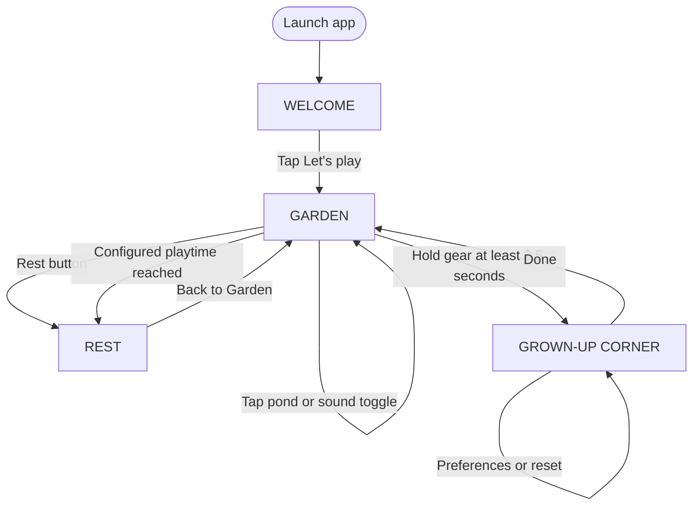
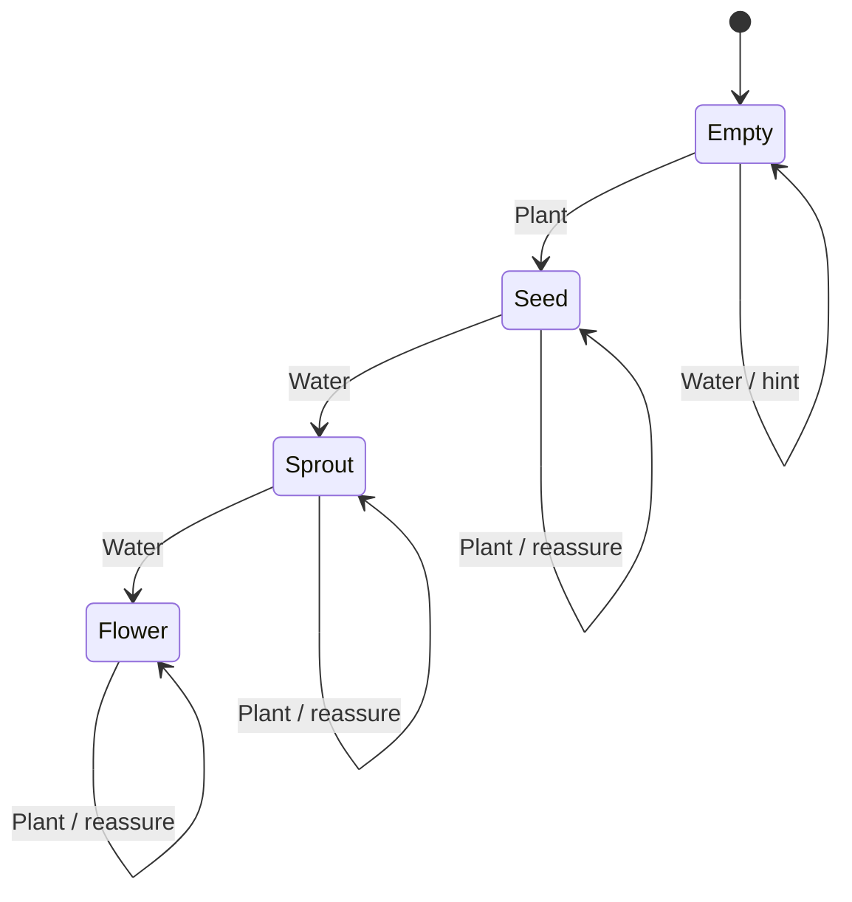
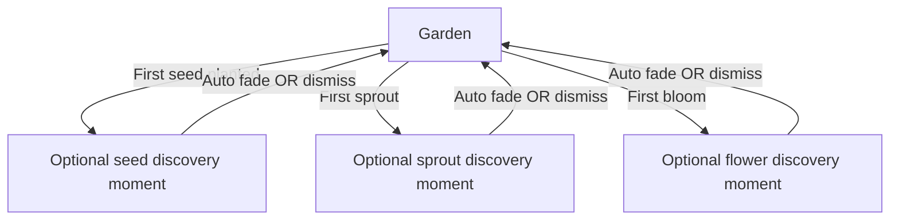

# SCREEN FLOW — Little Wonder Garden

**Status:** v1.0 approved design baseline / implementation-aligned specification. **Owners:** product + UI/game developer. **Canonical machine-readable contract:** [contracts/screen-flow.v1.json](contracts/screen-flow.v1.json). **Source implementation:** [../scripts/garden_game.gd](../scripts/garden_game.gd). **Reference canvas:** 1280 × 800 landscape.

> The implemented MVP has **four screens**, not a multi-page story mode. Storybook is the visual/narrative treatment; future story moments should be nonblocking overlays inside Garden, not new forced steps. Proposed experiences are clearly labeled below. Visual mockups are never proof of real device rendering.

## 1. Complete implemented navigation

Screen IDs in code: `welcome`, `garden`, `rest`, `parent`. A child can stop playing at any point using the device controls; no completion path is required. Soft rest reminders do not lock play.

## 2. Screen contracts (actual MVP)

| ID | Visual hierarchy / content | Child or parent interaction | Result | Evidence needed |
|---|---|---|---|---|
| `welcome` | Title, three flower sprites, reassuring subtitle, large central Let's play | Tap / mouse release on large central action | `garden` | After engine splash, screenshot must show illustration, not home/grey screen |
| `garden` | Top-left garden title; top-right parent gear; left Plant/Water/Sound/Rest rail; 3×3 beds center; pond to the right; bottom gentle hint | Tool selection + tap/drag each bed; pond; sound; rest | Save growth; change tools; cue; rest/parent | Distinct screenshots for empty, seed, sprout, flower, sound toggle |
| `rest` | Calm night/moon card, gentle invitation, one large Back to Garden | Return whenever ready | `garden`; garden play timer restarts | Rest screenshot and return test |
| `parent` | Grown-up Corner card: sound, reminders, 5/10/15-min interval, clear saved garden, Done | Hold gear 2.5s to enter; tap rows; two-tap destructive confirmation | Settings persist; reset only after confirmation; Done → garden | Long-press touch trace, visible parent screenshot, settings persistence, reset safeguards |

**Reference geometry from current code** (coordinates are in the 1280×800 *design* canvas, not raw ADB pixels):

| Hit target | Rect/circle | Note |
|---|---|---|
| Welcome Play | `Rect2(422,569,436,111)` | Large child-friendly target |
| Plant / Water / Sound / Rest | `Rect2(40,186,190,100)`; `(40,305,190,100)`; `(40,424,190,100)`; `(40,543,190,100)` | Tool rail |
| Plot grid | origin `(314,181)`, step `(237,154)`, size `(202,126)`, 3×3 | Nine patches, column-major? **No:** row = index / 3; col = index % 3 |
| Pond | center `(1126,527)`, radius `68` for tap | One gentle bird sound, not a separate screen |
| Grown-up gear | `Rect2(1160,22,92,82)` (hold); movement tolerance `Rect2(1148,15,110,99)` | **Automated emulator hold still failing**, do not label tested |
| Rest return | `Rect2(424,554,434,103)` | No penalty or streak |
| Parent settings rows | `(403,231,474,69)`, `(403,314,474,69)`, `(403,397,474,69)`, `(403,480,474,55)` | Sound / Break toggle / Minutes / Reset |
| Parent Done | `Rect2(464,555,350,89)` | Returns to garden |

**Critical UI rule:** all hit targets must transform through the same letterbox/inset coordinate mapping as the rendered canvas. An emulator `adb shell input swipe` uses physical display coordinates; do not naively reuse design coordinates. Code currently uses `_design_point`; test its behavior on actual system bars/4:3/16:10 screens. Do not expand plot touches under the parent gear or outside Garden.

## 3. Garden interaction state chart

- Nine independent plots, `plots[0..8]`, integer values 0=empty, 1=seed, 2=sprout, 3=flower.
- One tool is active (`seed` by default; `water` optional); dragging across different plots should not apply twice to the same plot during one gesture.
- Flower variety is deterministic, not a loot box: `FLOWER_ART[index % 6]` in order cosmos, sunflower, tulip, daisy, poppy, bluebell.
- Short seed/water/bloom/bird WAV files are local. No loud surprises, time-limit, wrong-answer marker or vanishing plants.
- On state/pref change, write `user://little_wonder_garden.json` version 1. Preserve backward compatibility or add tested migration before changing this contract.

## 4. Device-specific layout specification

Layout goal: **one dominant garden canvas**, predictable left tools, short text labels, generous tap areas and calm breathing space. The 1280×800 design coordinates are the logical reference only.

- **16:10** (1280×800): reference, no crop; honor Android bars and iPad safe-area.
- **4:3** (e.g. iPad): uniform fit with breathing margins or adjusted framing; **never stretch plants or crop controls**; validate all four screens.
- **16:9**: uniform fit/letterbox; keep Garden tool rail and parent gear fully visible.
- Rotate/resize: landscape lock in v1, preserve state if OS interrupts; no accidental reset; verify actual manifest behavior.
- Minimum touch target target: approximately **48 physical dp Android / 44 pt iPad** where feasible; v1 current targets are much larger in reference pixels. Recheck physical size after scaling.
- Use contrast between green button and pale card; avoid relying only on color; icon + short word should distinguish tools. Do not place primary taps against system navigation regions.
- Animations: one slow leaf/flower sway (tiny amplitudes); no strobes, transitions longer than needed or confetti; honor future reduce-motion setting.

## 5. Storybook UX layer — future optional extension (NOT implemented)

These are **brief, non-modal visual/audio cues within Garden**, not compulsory text pages. They must not block the next tap, require reading, collect metrics, award points or extend play. Proposal must pass child observation and accessibility review before implementation. A full storybook chapter or new scene needs a separate versioned screen-flow contract and PR.

## 6. Acceptance / traceability

| Test ID | Contract | Expected observable evidence |
|---|---|---|
| FLOW-01 | Launch → Welcome → Garden | Real app foreground + **bright illustrated** Welcome and Garden screenshots |
| FLOW-02 | Plant, water twice, all nine plots | Distinct progression, no double event during a drag, saves persisted |
| FLOW-03 | Pond and sound toggle | Cues only when sound is enabled, no errors |
| FLOW-04 | Voluntary and timed Rest → Garden | No lockout; break config respected |
| FLOW-05 | 2.5s parent hold | No access on short tap; visible settings on held press; no gesture fall-through |
| FLOW-06 | Parent preferences and reset | 5/10/15 cycle; first reset arms, second clears; cancel keeps garden |
| FLOW-07 | Restart, background/resume, offline | Saved plots/preferences intact, zero external calls |
| FLOW-08 | Responsive & accessible | 4:3, 16:10, 16:9 captures, no clipping/overlaps, meaningful large touches |
| FLOW-09 | Android + iPad builds | Native exported installable app tested on **real** tablet of each platform |

Do not close FLOW-05 or FLOW-09 based only on compilation. Link actual CI run, commit SHA, anonymized screenshots/logs and device details in [QA](QA.md) and [Issue #3](https://github.com/nandahtoon/MyLittleGarden/issues/3).

## 7. Controlled change process

Any new screen must update **all three**: this document, `docs/contracts/screen-flow.v1.json`, and the automated/manual acceptance tests. If the game code disagrees with the contract, mark the mismatch as a gap and fix in its own PR; do not silently rewrite a contract to make broken behavior pass.
