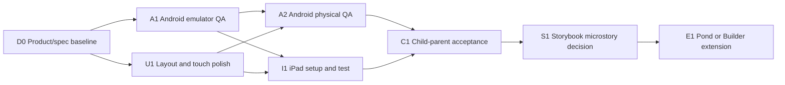

# WORK PACKAGES — cross-agent delivery board

**Policy:** [START_HERE](START_HERE.md) first; `origin/main` is authoritative. This is a **planned backlog**, not a claim of completed work. Source code, PR checks and Issue #3 are the evidence. Agents should not implement two overlapping branches for the same outcome.

## Goal → outcomes → outputs

**Goal:** a calm, attractive, offline storybook garden that a young child can use safely on Android tablet and iPad.

| Outcome | Output | Verification |
|---|---|---|
| A child can explore without pressure | 4-screen UI + nine plots + Plant/Water/Rest | Supervised usability notes; FLOW tests |
| Parent controls work | Hold-entry, sound, breaks, two-tap reset | Emulator **and real device** input and save evidence |
| Art looks like a cohesive book | Eight local SVGs + world rules + readable screen visuals | Actual device screenshots and review |
| Native apps are credible | Signed test builds, screenshots, logs, tested save | Android/iPad device-specific QA |
| A new agent can continue work | Versioned specs, machine contract, work packages, issue/PR conventions | Independent repo-only onboarding exercise |

## Status definition (no ungrounded percentages)

- **DONE:** committed to main and verified with linked evidence at the exact head.
- **GREEN:** clear reversible task, no approval/secret/device needed.
- **YELLOW:** implementation possible but experiment/test evidence or integration is uncertain; do not merge unsupported claims.
- **RED:** requires a user/parent/security/platform decision or unavailable physical device; document and stop this aspect.
- **BLOCKED:** explicit upstream prerequisite, not generic delay.

## Delivery graph



## Concrete work packages

| ID / priority | Safe status | Owner boundary | One coherent deliverable | Dependencies and acceptance |
|---|---|---|---|---|
| **D0 / P0** | GREEN | Docs/integrator | Harmonize `START_HERE`, `SCREEN_FLOW`, JSON, `STORYBOOK_BIBLE`, `GAME_DESIGN`, README/AGENTS links; source-backed mismatch register | No gameplay change; structured files parse; links valid; docs PR merged |
| **A1 / P0** | YELLOW | Native/QA agent, **existing PR #9** | Fix emulator launch variability; verify full 4-screen workflow, 2.5s parent hold, reset, screenshots/logs; preserve visual artifact | Run on exact PR head; no false-positive grey/home screenshots; test needs to finish green |
| **A1a / P0** | GREEN | Same PR #9 owner | Record duration/coordinates and press/move/release/hold timer to diagnose why `LWG_CI_GEAR_HIT` occurs without `PARENT_OPEN` | Reproduce, explain mechanism, targeted regression test; coordinate no competing writer |
| **U1 / P1** | YELLOW | UI/game developer | Native responsive UI audit of 4 screens; correct safe areas/drag/hold if evidence demands | Requires screenshot comparisons at 4:3/16:10/16:9; stage and save invariants intact |
| **A2 / P1** | RED until device | Android QA / parent | Install latest controlled ARM debug APK on physical Android tablet; sound, touch, offline, resume, save, Rest, parental gate | Android tablet and access; anonymized results in Issue #3 |
| **I1 / P1** | RED until Mac/iPad | iPad build/QA | Matching iOS export and Xcode signing plus device tests | macOS/Xcode + signing + actual iPad; never assert passed without these |
| **C1 / P1** | BLOCKED on A2/I1 | Product/UX + parent | Short voluntary 5–10 min supervised feedback study (no recording) on comprehension and easy stopping | Anonymized observations, zero PII, no child identity data |
| **S1 / P2** | YELLOW design-only | Creative/storybook | Optional microstory illustration/copy proof-of-concept with skippable nonmodal cues | Base screen UX validated; owner approves scope, no playtime pressure |
| **E1 / P3** | RED scope decision | Creative/game dev | Pond full-screen activity or Tiny Builder *only after explicit scope selection* | New flow contract, save plan, art, QA and child-safety review |

**Do not mark A1 complete because:** run `40450371655` rendered Welcome/Garden/Flower/Rest but failed Parent; later `40451931289` logs showed gear touch recognized yet panel did not open. Latest status must be queried from GitHub.

## Agent queue order and coordination

1. Integrator fetches latest repo refs/PRs, reads handoff, records selected work package on its PR and confirms no conflicting writer.
2. **One agent works A1** on existing PR #9; do not open a second emulator implementation. If branch owner inactive, coordinate before continuing.
3. In parallel a **docs-only agent** may finish D0 because files do not overlap the emulator test branch.
4. On credible emulator QA, physical Android and iPad test work can proceed independently.
5. UX/art changes get their own PR only after a reproducible issue or approved creative brief; never bury such changes in QA instrumentation.
6. Review design/code consistency on PR and update affected contracts before merging to `main`.

## PR definition of done

```
Outcome / work package ID:
Files changed:
Implementation vs concept:
Exact head commit:
Evidence URL(s), screenshots:
Checks run + result:
Not-run checks:
Behavioral/child-safety assessment:
Save compatibility:
Rollback:
Open blockers:
```

For documentation-only changes, static validation, truthful content and valid links are the checkable gate; **do not require** physical Android/iPad tests to merge docs that do not touch the game. For game/UI/engine changes, require appropriate native evidence.

## Explicit decisions needing a parent/project owner

- Whether to turn on/off voice narration or add Myanmar translation and who will validate recordings.
- Whether a future Pond should be a full-screen mini-world or remain ambient.
- Whether to introduce optional Pip character or keep garden itself as hero.
- Whether to pursue release in Google Play / Apple Kids and the corresponding privacy/legal reviews.
- Whether to permanently change Godot 4.4.1 after comparing Android emulator and real device evidence.

Existing **non-decisions**: no forced daily engagement, ads, leaderboards, social chat, child recording, external telemetry or cloud accounts.

## Completion report format

Summarize `DONE / WORKING / BLOCKED`, concrete artifact, exact SHA + CI link, screenshot/device proof, next safe package and external decisions. Keep it compact, never fabricate elapsed percentages.
